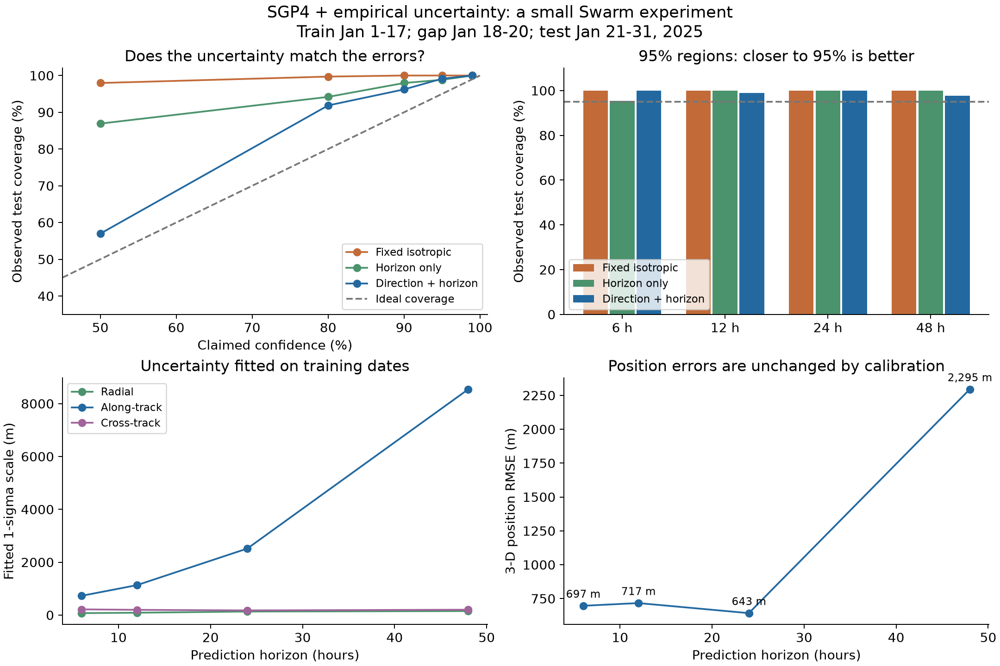
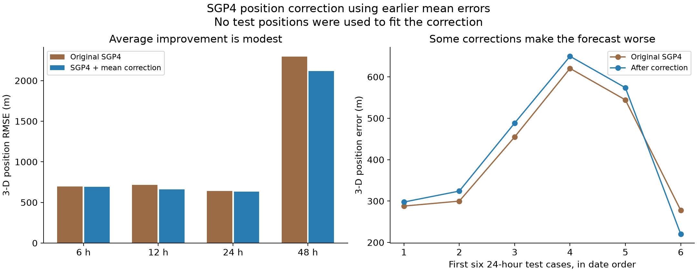
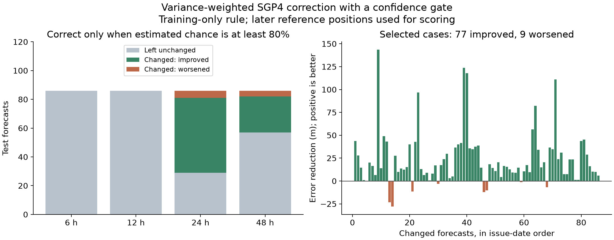

# SGP4 variance calibration and selective position correction

A small Python project using historical Swarm orbital elements and precise reference trajectories. It includes three experiments, saved results, plots, and a downloader that recreates the required data folders.

**Raw data are not committed.** There are no notebooks or proposal documents. The `data/` directory is created locally by the downloader and is excluded from Git. Git LFS is not required.

## What this project tests

1. **Uncertainty calibration:** keep the SGP4 position unchanged, but learn how large its errors are in different orbital directions and at different prediction horizons.
2. **Mean position correction:** use average historical errors to shift a later SGP4 position prediction.
3. **Selective correction:** use historical variance to shrink uncertain corrections, then apply a correction only when its model-estimated chance of helping exceeds a fixed threshold.

The reference trajectory is an independently reconstructed estimate based on tracking observations. It is not generated by SGP4 and is not perfectly known truth.

## Quick start

Use **Python 3.12**. The downloader uses only Python's standard library and public URLs; it needs no account, API key, or Git LFS installation.

From the repository root:

```bash
python3.12 -m venv .venv
.venv/bin/python -m pip install -r requirements-lock.txt
.venv/bin/python scripts/download_data.py
.venv/bin/python scripts/run_all.py
```

On Windows, replace `.venv/bin/python` with `.venv\Scripts\python.exe`.

The default download fetches **108 source files, about 53 MB**, and prepares about 220 MB of local inputs including extracted reference orbits. It downloads exactly the historical Swarm products used by the experiments, plus the Earth-orientation inputs and pinned TLE-source metadata. All download URLs and historical hashes are in [`config/source_manifest.json`](config/source_manifest.json).

To also obtain the extra data from the original project collection:

```bash
.venv/bin/python scripts/download_data.py --all
```

This adds the complete ESA conjunction release, CelesTrak snapshots, space-weather data, and source documentation. The full collection uses approximately 1 GB after extraction. These extra datasets are **not needed or used by the three experiments**.

Run individual experiments in this order:

```bash
.venv/bin/python experiments/sgp4_uncertainty_pilot/run_experiment.py
.venv/bin/python experiments/sgp4_position_correction_pilot/run_experiment.py
.venv/bin/python experiments/sgp4_confidence_gated_correction/run_experiment.py
```

The first experiment writes the error dataset used by the other two. Saved results are already committed, so you can read the reports and inspect the plots before installing anything.

## Repository structure

```text
.
├── README.md
├── requirements.txt                 # Five primary numerical packages
├── requirements-lock.txt            # Tested runtime dependency versions
├── .gitignore                       # Excludes downloaded data and environments
├── config/
│   └── source_manifest.json         # Public source URLs and archived SHA-256 hashes
├── scripts/
│   ├── download_data.py             # Download and organize inputs
│   ├── prepare_data.py              # Unpack, validate, and build matching indexes
│   ├── verify_data.py               # Check local source/prepared-file hashes
│   ├── run_all.py                   # Run all experiments in sequence
│   ├── check_results.py             # Check saved numerical results and invariants
│   └── check_github_ready.py         # Check what will actually be committed
├── experiments/
│   ├── sgp4_uncertainty_pilot/
│   ├── sgp4_position_correction_pilot/
│   └── sgp4_confidence_gated_correction/
└── docs/
    ├── METHODS.md
    ├── DATA_SOURCES.md
    ├── DATA_GUIDE.md                 # Full original collection guide
    ├── GITHUB.md
    └── source-notices/
```

Each experiment directory contains `run_experiment.py`, `report.md`, `summary.json`, and `results.png`. The first also includes `prediction_errors.json`. The correction experiments include `corrected_positions.json`, containing the computed positions and scored errors. These are **experiment outputs**, not the downloaded input data.

The default downloader creates this layout:

```text
data/
├── manifest.json
├── prepared_files_manifest.json
├── validation_summary.json
├── download_failures.json
├── calibration_pairs_index.csv
├── orbit_predictions/
│   ├── historical/                   # Swarm A/B/C historical TLE files
│   └── calibration_window/           # Deduplicated TLE subsets around Jan 2025
├── reference_orbits/
│   ├── index.csv
│   ├── swarm_A/                      # Daily ZIP files and extracted SP3/HDR files
│   ├── swarm_B/
│   └── swarm_C/
├── earth_orientation/
└── metadata/
```

`--all` also creates `conjunctions/`, `space_weather/`, `documentation/`, and additional orbital snapshots. A custom data location is supported:

```bash
.venv/bin/python scripts/download_data.py --data-dir /path/to/data
.venv/bin/python scripts/run_all.py --data-dir /path/to/data
```

For an individual experiment with a custom location, set `SGP4_DATA_DIR` before running its script.

## Data and experimental split

| Satellite | NORAD ID | SP3 ID |
|---|---:|---|
| Swarm A | 39452 | L47 |
| Swarm B | 39451 | L48 |
| Swarm C | 39453 | L49 |

The historical reference products contain **102 daily files and 881,280 position/velocity epochs**, sampled every 10 seconds. They span late December 31, 2024 through February 3, 2025 in UTC. The matching index contains **980 forecasts** at horizons of 6, 12, 24, and 48 hours.

| Split | TLE issue dates, 2025 | Forecast comparisons |
|---|---|---:|
| Training | January 1–17 | 540 |
| Excluded gap | January 18–20 | 96 |
| Testing | January 21–31 | 344 |

The 344 test comparisons come from 86 TLE issue records, evaluated at four horizons. They are correlated, not 344 independent observations. The gap prevents training forecast targets from overlapping the test issue period. All fitted corrections and confidence rules use training data only. The correction experiments reuse the same test period, so the sequence is exploratory rather than new independent validation at every step.

SGP4/WGS72 predicts a position from the older TLE. The precise reference is interpolated at the same future timestamp. Both are expressed in the same coordinate frame before subtraction:

$$e=r_{\mathrm{reference}}-r_{\mathrm{SGP4}}.$$

Errors are expressed in the **radial, along-track, and cross-track** directions, abbreviated RTN. Radial points away from Earth; along-track follows the orbital motion; cross-track is normal to the orbital plane. The basis is computed from the SGP4 prediction, not the future reference.

## Experiment 1: calibrated uncertainty

SGP4 does not supply a covariance. We create explicit uncertainty baselines and fit them using the same training dates.

For each direction $j$ and horizon $h$, the directional model estimates:

$$\hat\sigma_j^2(h)=\frac{1}{N_h}\sum_i e_{i,j}(h)^2.$$

The position remains unchanged. This is the mean squared error about the SGP4 position, including any uncorrected bias. It is not a centered variance after subtracting a fitted mean. Three-dimensional Gaussian coverage is checked at five confidence levels: 50%, 80%, 90%, 95%, and 99%.

| Model | Average coverage mismatch | Mean negative log-likelihood |
|---|---:|---:|
| One fixed isotropic uncertainty | 16.7 percentage points | 26.47 |
| Horizon-only isotropic control | 12.8 percentage points | 24.55 |
| Separate directions and horizons | **6.0 percentage points** | **21.56** |

Lower is better for both measures. A claimed 50% uncertainty region contains 98.0% of test reference positions for the fixed baseline and 57.0% for the directional model. The latter is closer to 50%. However, its claimed 95% regions contain 99.1%, so it is still conservative. It does not win every confidence level or horizon. Position errors are unchanged.

[Experiment report](experiments/sgp4_uncertainty_pilot/report.md) · [Numerical summary](experiments/sgp4_uncertainty_pilot/summary.json)



## Experiment 2: mean position correction

Variance alone gives no direction for a position correction. We therefore learn the average RTN error from earlier data:

$$\hat b(h)=\operatorname{mean}_{\mathrm{training}} e_{\mathrm{RTN}}(h),\qquad
r_{\mathrm{corrected}}=r_{\mathrm{SGP4}}+B_{\mathrm{RTN}}^T\hat b(h).$$

The rows of $B_{\mathrm{RTN}}$ are the predicted local unit vectors. The bias is pooled across all three satellites and fitted separately by horizon. Future reference positions are used only to measure the test error.

| Horizon | Original 3-D RMSE | Corrected RMSE | Reduction | Cases improved |
|---|---:|---:|---:|---:|
| 6 h | 697.0 m | 693.6 m | 0.50% | 36/86 |
| 12 h | 716.9 m | 661.7 m | 7.70% | 48/86 |
| 24 h | 642.7 m | 632.9 m | 1.53% | 44/86 |
| 48 h | 2,294.9 m | 2,118.1 m | 7.70% | 58/86 |

Across all forecasts, 186 improve and 158 worsen. Overall RMSE falls by 6.77%, but median distance error rises from 566.9 to 572.5 m. RMSE emphasizes large errors; improving it does not guarantee improvement in the typical or individual case. The report shows the first six chronological 24-hour examples, including failures.

[Experiment report](experiments/sgp4_position_correction_pilot/report.md) · [Corrected positions](experiments/sgp4_position_correction_pilot/corrected_positions.json)



## Experiment 3: variance-weighted correction with a confidence gate

This experiment fits mean errors $\mu$ and centered variances $s_j^2$ separately for each satellite/horizon group. It shrinks components that have a large random spread relative to their bias:

$$w_j=\frac{\mu_j^2}{\mu_j^2+s_j^2},\qquad d_j=w_j\mu_j.$$

For a fitted Gaussian error model $e\sim\mathcal N(\mu,C)$, a fixed correction $d$ helps when $e^Td>\|d\|^2/2$. Its model-estimated chance of helping is:

$$p=\Phi\!\left(\frac{\mu^Td-\|d\|^2/2}{\sqrt{d^TCd}}\right).$$

Here $C$ is diagonal and $\Phi$ is the standard normal cumulative distribution function. Apply the correction only if **$p\ge0.80$**. Otherwise preserve the original position exactly. The threshold was fixed before scoring this experiment's test outcomes.

| Outcome | Forecasts |
|---|---:|
| Left unchanged | 258 |
| Changed and improved | 77 |
| Changed and worsened | 9 |

Of the 86 changed forecasts, **89.5% improve**. Their RMSE falls from 1,057.6 to 1,045.9 m. Across all forecasts, RMSE falls from 1,292.2 to 1,289.8 m, only **0.19%**. The selected groups are Swarm A/24 h, Swarm C/24 h, and Swarm B/48 h.

The confidence is an uncalibrated model estimate, not a guarantee. All forecasts in a satellite/horizon group receive the same confidence. Satellite-specific fitting and variance shrinkage also differ from Experiment 2; the report includes same-model ungated controls to distinguish those changes from the gate itself.

[Experiment report](experiments/sgp4_confidence_gated_correction/report.md) · [Group parameters and controls](experiments/sgp4_confidence_gated_correction/summary.json)



## Reproducibility, validation, and limits

- GPS/UTC time, SP3 units, and reference frames are handled explicitly. The code uses cubic Hermite interpolation and compares it with an independent local polynomial interpolation. Position-frame round trips and explicit rotation checks are included.
- Historical TLE, precise-orbit ZIP, and ESA-release downloads must match their archived SHA-256 hashes. Download and prepared-file manifests record sizes and hashes. `scripts/verify_data.py` checks the resulting local files.
- IERS tables and optional live CelesTrak/space-weather/documentation endpoints can change. Their new hashes and timestamps are recorded, rather than silently claiming byte-for-byte reproduction of the old snapshot. Saved results describe the original experiment inputs.
- There is no verified maneuver log. No maneuver periods were definitively removed and no test residuals were clipped. Some training errors reach about 58 km at 48 hours and influence the fitted scales.
- The tests cover one month and three related spacecraft, with temporal and cross-satellite correlation. A new independent period is needed to confirm the gains and calibrate confidence estimates.
- Position corrections at separate horizons do not constitute a dynamically consistent new orbital propagator.
- These experiments do not implement collision probabilities, orbital state-transition matrices, or avoidance-maneuver optimization.

See [Methods](docs/METHODS.md), [data sources](docs/DATA_SOURCES.md), [the archived full-data guide](docs/DATA_GUIDE.md), and [packaging validation](docs/VALIDATION.md). The downloader supports restarting after a failed transfer; completed matching files are cached. It reports failed downloads instead of accepting an HTML error page as a dataset.

## Push this GitHub version

The repository has a local `codex/github-ready` branch. Create an **empty** GitHub repository, then run:

```bash
python3.12 scripts/check_github_ready.py
git remote add origin https://github.com/YOUR_USERNAME/YOUR_REPOSITORY.git
git push -u origin HEAD:main
```

Replace the example URL. The last command maps the local commit to remote `main`. If `origin` already exists, inspect it with `git remote -v` and update the URL if needed. No remote repository is created and nothing is uploaded by preparing this folder.

The preflight check rejects accidentally staged raw data, environments, notebooks, and files above GitHub's ordinary-file limit. `data/` remains ignored even after downloads, so running the experiments will not stage hundreds of megabytes of inputs. Details are in [GitHub instructions](docs/GITHUB.md).

## Attribution and licensing

Public data remain subject to their providers' terms. The source TLE repository's license and README are preserved in `docs/source-notices/`. ESA reference products, the ESA conjunction release, GFZ indices, and IERS products have separate attribution and usage terms. No blanket license or new open-source license has been assigned to the original course-project code. See [data-source notices](docs/DATA_SOURCES.md).

Course context: 06-623, Fall 2026. Team: Madhav Agrawal, Abhinav Raghuvanshi, and Gayatri S. Moghe.
