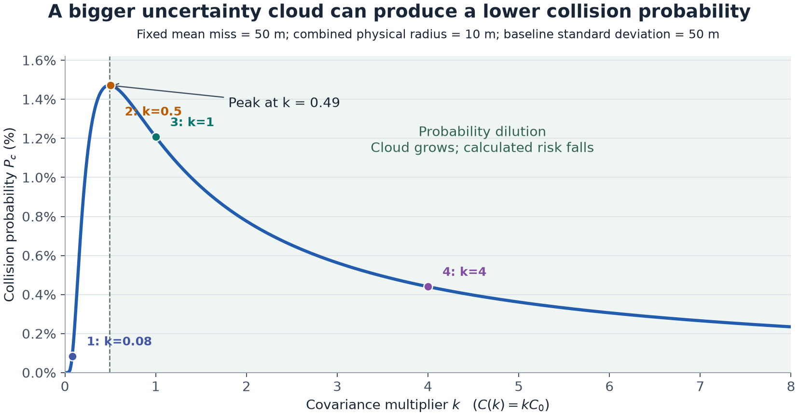
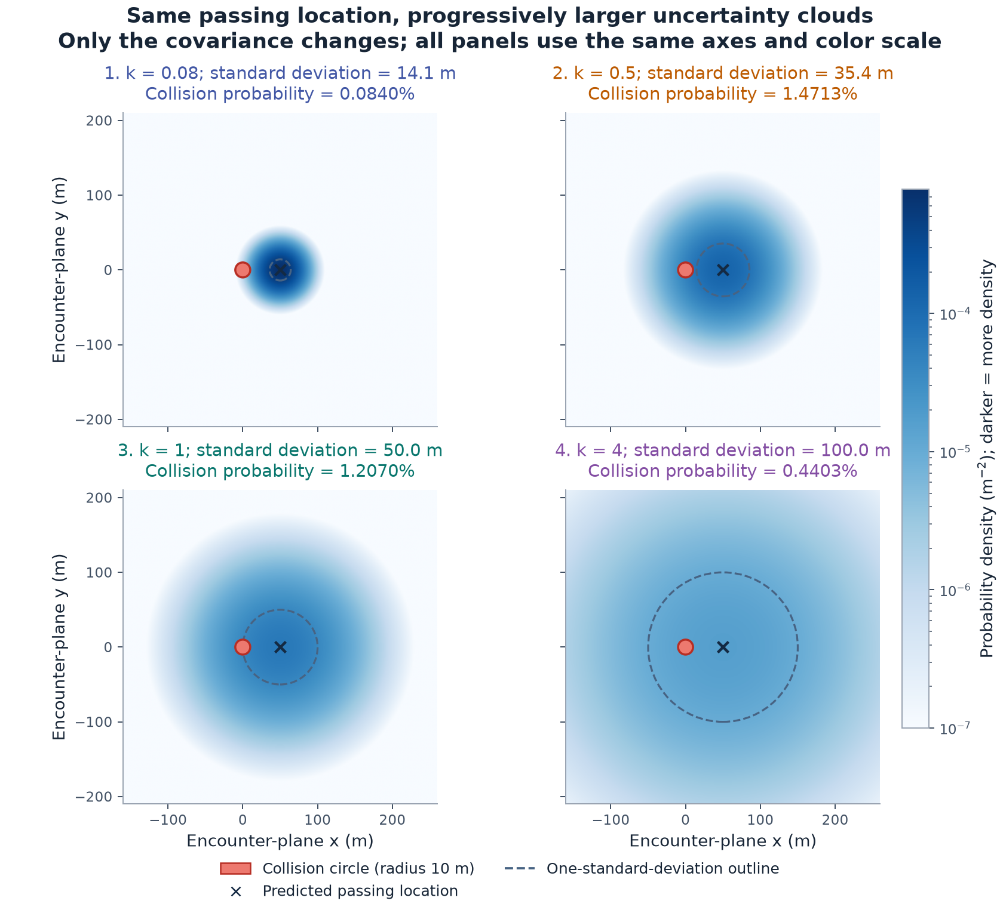

# Collision Avoidance: My Understanding

## 1. Objective

Learn realistic SGP4 prediction errors, calculate collision risk, and find the smallest velocity change that reduces that risk below a chosen limit.

**TLE + reference orbit → errors → bias and covariance → relative uncertainty → collision probability → maneuver.**

## 2. What data do we have?

### Prediction and reference data

| Data in Project/data/ | What it contains |
|---|---|
| orbit_predictions/historical/ | Historical TLEs for Swarm A, B, and C. Run SGP4 on these to generate predictions. |
| reference_orbits/swarm_A/, swarm_B/, swarm_C/ | ESA precise reference orbits in SP3 files: timestamped position and velocity. These are processed reference trajectories, not raw GPS measurements. |
| calibration_pairs_index.csv | Which TLE and reference file to compare, at which time; horizons are 6, 12, 24, and 48 hours. Errors have not yet been calculated. |

Treat the reference orbit as approximate truth. Its remaining error matters if it is not small compared with SGP4 error.

There are also ESA historical conjunction records, SOCRATES close-approach cases, and supporting frame/time and space-weather data. The anonymous ESA events are separate from the identified Swarm calibration data; they cannot be joined by satellite ID.

### What is inside a TLE?

A TLE has two lines of numbers describing a fitted orbit at an **epoch**: the time those numbers refer to. Sometimes a satellite-name line comes before them.

| Field | Easy meaning |
|---|---|
| Satellite ID and launch identifier | Which object this is. |
| Epoch | Reference date and time. |
| Inclination | Tilt of the orbit relative to Earth's equator. |
| RAAN | Direction of the orbit's equator crossing, from south to north. |
| Eccentricity | How stretched the orbit is; near zero means nearly circular. |
| Argument of perigee | Orientation of the point nearest Earth within the orbit. |
| Mean anomaly | An angle tracking progress around the orbit at the epoch. |
| Mean motion | Average revolutions per day. |
| Mean-motion derivative fields | Encoded rates of change of mean motion. |
| BSTAR | Fitted drag-related term used by SGP4. |
| Other fields | Classification, record/version information, revolution count, and checksums. |

Field reference: [CelesTrak TLE format](https://celestrak.org/NORAD/documentation/tle-fmt.php).

A TLE does **not** contain a table of future positions, GPS measurements, object radius, or a covariance matrix. SGP4 converts its fitted orbit parameters into position and velocity at a requested time.

## 3. Calculate prediction errors

For a TLE with epoch $t_0$, predict at $t=t_0+\tau$, where $\tau$ is the prediction horizon:

$$
\boxed{\mathbf e_{\mathrm{ECI}}(t)
=\mathbf r_{\mathrm{ref}}(t)-\mathbf r_{\mathrm{SGP4}}(t)}
$$

Interpolate the reference to the comparison time. Convert both positions to the same coordinate system, time scale, and units first. In our files, SGP4 outputs TEME, whereas SP3 uses terrestrial coordinates and GPS time.

Express errors in the orbit's local **RTN** directions: radial (away from Earth), transverse (approximately along the orbit), and normal (out of the orbit plane).

Using reference position $\mathbf r$ and velocity $\mathbf v$ at that time, in ECI:

$$
\hat{\mathbf R}=\frac{\mathbf r}{\|\mathbf r\|},\qquad
\hat{\mathbf N}=\frac{\mathbf r\times\mathbf v}{\|\mathbf r\times\mathbf v\|},\qquad
\hat{\mathbf T}=\hat{\mathbf N}\times\hat{\mathbf R}
$$

$$
\mathbf U=[\hat{\mathbf R}\ \hat{\mathbf T}\ \hat{\mathbf N}],
\qquad
\mathbf e=\mathbf U^T\mathbf e_{\mathrm{ECI}}
=\begin{bmatrix}e_R\\e_T\\e_N\end{bmatrix}
$$

This lets us compare “ahead/behind the prediction” across different orbital positions. Group errors by horizon, and remove or separately model maneuver intervals.

## 4. Calculate bias and covariance from the errors

Take $K\ge2$ error vectors from the same horizon bin, expressed in RTN:

$$
\mathbf e_k=\begin{bmatrix}e_{k,R}\\e_{k,T}\\e_{k,N}\end{bmatrix},
\qquad k=1,\ldots,K
$$

### Bias: average error in each direction

$$
\boxed{\mu_j=\frac1K\sum_{k=1}^{K}e_{k,j},\quad j\in\{R,T,N\}}
\qquad
\boldsymbol\mu=\begin{bmatrix}\mu_R\\\mu_T\\\mu_N\end{bmatrix}
$$

### Covariance: all six distinct entries

The three diagonal entries are variances:

$$
\begin{aligned}
P_{RR}&=\frac1{K-1}\sum_{k=1}^{K}(e_{k,R}-\mu_R)^2\\
P_{TT}&=\frac1{K-1}\sum_{k=1}^{K}(e_{k,T}-\mu_T)^2\\
P_{NN}&=\frac1{K-1}\sum_{k=1}^{K}(e_{k,N}-\mu_N)^2
\end{aligned}
$$

The other entries measure how errors in two directions vary together:

$$
\begin{aligned}
P_{RT}&=\frac1{K-1}\sum_{k=1}^{K}(e_{k,R}-\mu_R)(e_{k,T}-\mu_T)\\
P_{RN}&=\frac1{K-1}\sum_{k=1}^{K}(e_{k,R}-\mu_R)(e_{k,N}-\mu_N)\\
P_{TN}&=\frac1{K-1}\sum_{k=1}^{K}(e_{k,T}-\mu_T)(e_{k,N}-\mu_N)
\end{aligned}
$$

Assemble the symmetric matrix:

$$
\boxed{\mathbf P_{\mathrm{RTN}}=
\begin{bmatrix}
P_{RR}&P_{RT}&P_{RN}\\
P_{RT}&P_{TT}&P_{TN}\\
P_{RN}&P_{TN}&P_{NN}
\end{bmatrix}}
$$

Every entry has units of $\mathrm{m}^2$. The standard deviations are $\sigma_R=\sqrt{P_{RR}}$, $\sigma_T=\sqrt{P_{TT}}$, and $\sigma_N=\sqrt{P_{NN}}$.

The same calculation in compact form is:

$$
\boxed{\mathbf P_{\mathrm{RTN}}=
\frac1{K-1}\sum_{k=1}^{K}
(\mathbf e_k-\boldsymbol\mu)(\mathbf e_k-\boldsymbol\mu)^T}
$$

These sample-covariance formulas do not require Gaussian errors. The **next modeling assumption** is that new errors approximately follow a Gaussian with this bias and covariance.

### Fit quadratics to describe error growth with horizon

The bin calculations above give bias and spread at specific horizons. Fit curves so we can evaluate them at any horizon $\tau$ within the range supported by the data.

For each direction $j\in\{R,T,N\}$, use:

$$
\boxed{\mu_j(\tau)=c_{j0}+c_{j1}\tau+c_{j2}\tau^2}
$$

$$
\boxed{\sigma_j(\tau)=s_{j0}+s_{j1}\tau+s_{j2}\tau^2}
$$

The first curve gives average error; the second gives **standard deviation**, not variance. Use $s_{j0}>0$ and $s_{j1},s_{j2}\ge0$ to keep spread positive and nondecreasing for $\tau\ge0$. Bias coefficients can have either sign.

The quadratic allows constant, linear, and quadratic growth: a velocity error accumulates roughly linearly in time; an acceleration error roughly quadratically. It is a fitted model, not an exact growth law.

Learn the six coefficients per direction from historical errors and their horizons. The proposal fits the Gaussian model by minimizing:

$$
\boxed{
\min_{\{c_{j0},c_{j1},c_{j2},s_{j0},s_{j1},s_{j2}\}}
\sum_{k=1}^{K}
\left[
\log\sigma_j(\tau_k)+
\frac{(e_{k,j}-\mu_j(\tau_k))^2}{2\sigma_j(\tau_k)^2}
\right]}
$$

Use one time unit consistently, such as days. The constant terms represent error at the TLE epoch: $\mu_j(0)=c_{j0}$ and $\sigma_j(0)=s_{j0}$. A current mean and covariance alone cannot determine all the growth coefficients; historical errors at multiple horizons are needed.

### Turn the fitted spreads into covariance at horizon tau

For a simple baseline, keep the directional correlations constant with horizon. Estimate a valid correlation matrix $\boldsymbol\Gamma$ from the standardized training errors:

$$
z_{k,j}=\frac{e_{k,j}-\mu_j(\tau_k)}{\sigma_j(\tau_k)},
\qquad
\gamma_{ij}=\operatorname{Corr}(z_{\cdot,i},z_{\cdot,j})
$$

Correlation is sample covariance divided by the two sample standard deviations, using the formulas above. Then:

$$
\boldsymbol\Gamma=
\begin{bmatrix}
1&\gamma_{RT}&\gamma_{RN}\\
\gamma_{RT}&1&\gamma_{TN}\\
\gamma_{RN}&\gamma_{TN}&1
\end{bmatrix},
\qquad
\mathbf D(\tau)=\operatorname{diag}
\big(\sigma_R(\tau),\sigma_T(\tau),\sigma_N(\tau)\big)
$$

$$
\boxed{\mathbf P_{\mathrm{RTN}}(\tau)
=\mathbf D(\tau)\boldsymbol\Gamma\mathbf D(\tau)}
\qquad
P_{ij}(\tau)=\gamma_{ij}\sigma_i(\tau)\sigma_j(\tau)
$$

For example, $P_{RR}(\tau)=\sigma_R(\tau)^2$ and $P_{RT}(\tau)=\gamma_{RT}\sigma_R(\tau)\sigma_T(\tau)$. Check that the resulting covariance is positive definite.

### Get the future position mean and covariance from the current TLE

Let $t_0$ be the current TLE's epoch, $t_{\mathrm{now}}$ the present time, and $h$ how far ahead from now we want to predict. The model's horizon is:

$$
\boxed{t=t_{\mathrm{now}}+h,\qquad
\tau=t-t_0=(t_{\mathrm{now}}-t_0)+h}
$$

So a TLE already 6 hours old, used to predict 18 hours ahead from now, requires $\tau=24$ hours, or 1 day.

1. Run SGP4 from that TLE to get $\mathbf r_{\mathrm{SGP4}}(t)$ and $\mathbf v_{\mathrm{SGP4}}(t)$.
2. Substitute $\tau$ into the quadratics to get $\boldsymbol\mu(\tau)$ and the three $\sigma_j(\tau)$; assemble $\mathbf P_{\mathrm{RTN}}(\tau)$.
3. Build $\mathbf U(t)$ from the predicted position and velocity using Section 3, after conversion to ECI.
4. Correct the prediction and rotate its covariance into ECI:

$$
\boxed{\mathbf m(t)=\mathbf r_{\mathrm{SGP4}}(t)
+\mathbf U(t)\boldsymbol\mu(\tau)}
$$

$$
\boxed{\mathbf P(t)=\mathbf U(t)
\mathbf P_{\mathrm{RTN}}(\tau)\mathbf U(t)^T}
$$

$$
\boxed{\mathbf r_{\mathrm{actual}}(t)\sim
\mathcal N\big(\mathbf m(t),\mathbf P(t)\big)}
$$

This empirical route directly supplies future covariance; no separate propagation of a current covariance is needed.

Bias moves the center; covariance describes the remaining spread. Validate on later, unseen data: a claimed 95% uncertainty region should contain approximately 95% of reference positions. Reference error is included in the measured spread unless accounted for.

## 5. Combine the uncertainties of two objects

For objects A and B at the same future time:

$$
\mathbf r_A\sim\mathcal N(\mathbf m_A,\mathbf P_A),
\qquad
\mathbf r_B\sim\mathcal N(\mathbf m_B,\mathbf P_B)
$$

The means are bias-corrected predictions. Their separation vector is:

$$
\mathbf d=\mathbf r_A-\mathbf r_B
$$

For independent prediction errors:

$$
\boxed{\mathbf d\sim\mathcal N(\bar{\mathbf d},\mathbf P_{\mathrm{rel}}),
\quad\bar{\mathbf d}=\mathbf m_A-\mathbf m_B,
\quad\mathbf P_{\mathrm{rel}}=\mathbf P_A+\mathbf P_B}
$$

**Subtract means, add covariances.** Both covariances must be in the same frame. Correlated errors require cross-covariance terms too.

This is a distribution for the separation vector, not its length. Swarm-derived error statistics need validation before applying them to unrelated satellites or debris.

## 6. Calculate collision probability

### Physical collision distance and closest approach

Approximate the objects by spheres of physical radii $R_A$ and $R_B$. A collision occurs if their centers pass within:

$$
R=R_A+R_B
$$

Find the time of predicted closest approach over the encounter being assessed:

$$
t_c=\operatorname*{arg\,min}_t\|\mathbf m_A(t)-\mathbf m_B(t)\|
$$

Evaluate the relative mean $\bar{\mathbf d}$, covariance $\mathbf P_{\mathrm{rel}}$, and velocity $\mathbf v_{\mathrm{rel}}=\mathbf v_A-\mathbf v_B$ at $t_c$. Here the velocities are the rates of change of the modeled mean positions.

### Build the encounter plane

For a fast, brief encounter, approximate relative motion as a straight line. The encounter plane is perpendicular to that line.

1. Normalize the relative velocity:

$$
\hat{\mathbf q}_3=\frac{\mathbf v_{\mathrm{rel}}}{\|\mathbf v_{\mathrm{rel}}\|}
$$

2. Choose a unit vector $\mathbf a$ that is not parallel, or nearly parallel, to $\hat{\mathbf q}_3$. Construct two perpendicular unit vectors in the plane:

$$
\hat{\mathbf q}_1=\frac{\hat{\mathbf q}_3\times\mathbf a}
{\|\hat{\mathbf q}_3\times\mathbf a\|},
\qquad
\hat{\mathbf q}_2=\hat{\mathbf q}_3\times\hat{\mathbf q}_1
$$

3. Put those vectors into a $3\times2$ matrix:

$$
\mathbf Q=[\hat{\mathbf q}_1\ \hat{\mathbf q}_2]
$$

### Calculate the passing location b and covariance C

Project the relative mean and uncertainty onto the plane:

$$
\boxed{\mathbf b=\mathbf Q^T\bar{\mathbf d}
=\begin{bmatrix}
\hat{\mathbf q}_1^T\bar{\mathbf d}\\
\hat{\mathbf q}_2^T\bar{\mathbf d}
\end{bmatrix}}
$$

$$
\boxed{\mathbf C=\mathbf Q^T\mathbf P_{\mathrm{rel}}\mathbf Q
=\begin{bmatrix}
\hat{\mathbf q}_1^T\mathbf P_{\mathrm{rel}}\hat{\mathbf q}_1&
\hat{\mathbf q}_1^T\mathbf P_{\mathrm{rel}}\hat{\mathbf q}_2\\
\hat{\mathbf q}_2^T\mathbf P_{\mathrm{rel}}\hat{\mathbf q}_1&
\hat{\mathbf q}_2^T\mathbf P_{\mathrm{rel}}\hat{\mathbf q}_2
\end{bmatrix}}
$$

$\mathbf b$ has two components in metres; $\mathbf C$ is $2\times2$ in $\mathrm{m}^2$. Any orthonormal axes in this plane give the same collision probability.

The uncertain passing location is:

$$
\mathbf z=\begin{bmatrix}X\\Y\end{bmatrix}
\sim\mathcal N(\mathbf b,\mathbf C)
$$

### Probability calculation

For a positive-definite covariance, the two-dimensional Gaussian density is:

$$
\boxed{p(\mathbf z)=\frac1{2\pi\sqrt{\det\mathbf C}}
\exp\left[-\frac12(\mathbf z-\mathbf b)^T
\mathbf C^{-1}(\mathbf z-\mathbf b)\right]}
$$

Collision probability is the probability inside the circle centered at the origin with radius $R$:

$$
\boxed{P_c=P(X^2+Y^2\le R^2)
=\iint_{x^2+y^2\le R^2}p(x,y)\,dx\,dy}
$$

Using polar coordinates gives a direct numerical calculation:

$$
\boxed{P_c=\int_0^{2\pi}\int_0^R
p(\rho\cos\theta,\rho\sin\theta)\,\rho\,d\rho\,d\theta}
$$

The extra factor $\rho$ accounts for area in polar coordinates. One simple approximation is a midpoint sum. Choose $N_r$ radial bins and $N_\theta$ angular bins:

$$
\Delta\rho=\frac R{N_r},\quad
\Delta\theta=\frac{2\pi}{N_\theta},\quad
\rho_i=(i-\tfrac12)\Delta\rho,\quad
\theta_j=(j-\tfrac12)\Delta\theta
$$

$$
\boxed{P_c\approx\Delta\rho\,\Delta\theta
\sum_{i=1}^{N_r}\sum_{j=1}^{N_\theta}
p(\rho_i\cos\theta_j,\rho_i\sin\theta_j)\,\rho_i}
$$

Increase the bin counts until the result stabilizes. The proposal uses Gauss–Legendre quadrature, a more efficient weighted sum for the same integral.

### Monte Carlo: intuition and cross-check

Draw $M$ random passing locations from $\mathcal N(\mathbf b,\mathbf C)$ and count those inside the collision circle:

$$
\boxed{\widehat P_c=
\frac{\text{samples with }X^2+Y^2\le R^2}{M}}
$$

For illustration, **100 hits out of 1,000,000 samples** gives:

$$
\widehat P_c=\frac{100}{1{,}000{,}000}=10^{-4}=0.01\%
$$

These are simulated possible encounters, not observed collisions. Rare probabilities need many samples. Slow encounters need a time-dependent three-dimensional treatment rather than this short-encounter approximation.

## 7. Probability dilution

Making the uncertainty cloud much wider can spread probability away from the small collision circle and lower $P_c$. That does not mean we know the encounter is safer.

### Example: multiply covariance by k

Keep the predicted passing location and object sizes fixed:

$$
\mathbf b=\begin{bmatrix}50\\0\end{bmatrix}\mathrm{m},
\qquad R=10\ \mathrm{m},
\qquad \mathbf C_0=(50\ \mathrm{m})^2\mathbf I_2
$$

Enlarge the cloud by multiplying covariance by a positive factor $k$:

$$
\boxed{\mathbf C(k)=k\mathbf C_0,\qquad
\sigma(k)=50\sqrt{k}\ \mathrm{m},\qquad
P_c(k)=\int_{\|\mathbf z\|\le R}
\mathcal N(\mathbf z;\mathbf b,k\mathbf C_0)\,d\mathbf z}
$$

Here $k$ multiplies **variance**, so $k=4$ doubles the standard deviation. The positions and physical sizes do not change.

The probability first rises, peaks near $k=0.5$, then falls: the **dilution region** is the falling part of the curve.

The red circle is the collision region; the cross is the unchanged predicted passing location. Dashed circles mark one standard deviation. $P_c$ is the probability mass inside the red circle, not simply the area where shapes overlap. These plots are an illustrative calculation, not results from our data.

Check whether the risk decision changes across plausible covariance sizes. A robust maneuver can enforce the risk limit across that range.

## 8. Find the required velocity change

A thruster burn at $t_b<t_c$ changes the predicted passing location:

$$
\mathbf b'\approx\mathbf b+\mathbf G(t_b)\Delta\mathbf v,
\qquad
\mathbf G(t_b)=\mathbf Q^T\boldsymbol\Phi_{rv}(t_c,t_b)
$$

$\boldsymbol\Phi_{rv}$ is a $3\times3$ sensitivity matrix calculated from orbital dynamics: how much position at $t_c$ changes per unit velocity change at $t_b$. Consequently, $\mathbf G$ is $2\times3$.

Solve for the smallest push:

$$
\boxed{\min_{\Delta\mathbf v}\|\Delta\mathbf v\|^2
\quad\text{subject to}\quad
P_c(\mathbf b+\mathbf G\Delta\mathbf v,\mathbf C)\le\varepsilon,
\quad\|\Delta\mathbf v\|\le\Delta v_{\max}}
$$

$\varepsilon$ is the risk limit; $\Delta v_{\max}$ is the burn limit. Minimizing squared magnitude gives the same optimum as minimizing magnitude. For the same spacecraft and engine, fuel for a small burn is approximately proportional to $\|\Delta\mathbf v\|$.

Try several burn times. Earlier burns often need less fuel, but orbital timing matters. This approximation holds covariance fixed during the small maneuver.

Verify by applying the burn in the full propagator, finding the new TCA, and recalculating $P_c$. Check for newly created close approaches too.

## 9. What to compare against

SGP4 alone supplies no covariance, so a probability-based baseline needs an explicitly chosen uncertainty model.

| Method | Position mean | Covariance |
|---|---|---|
| Baseline | Original SGP4 | Stated baseline covariance |
| Bias correction only | SGP4 + learned bias | Same baseline covariance |
| Full model | SGP4 + learned bias | Learned covariance |

Initially keep the encounters, burn time, optimizer, threshold, object sizes, and thruster limits the same. This separates the effects of bias correction and covariance learning. Study timing optimization afterward.

## 10. What counts as a good result?

For cases where both methods maneuver:

$$
\text{fuel saving}\approx100\left(1-
\frac{\|\Delta\mathbf v_{\mathrm{ours}}\|}
{\|\Delta\mathbf v_{\mathrm{baseline}}\|}\right)\%
$$

Fuel savings are useful if the uncertainty model works better on unseen data and both maneuvers satisfy a common evaluated risk limit. Evaluate them using the same simulator and independently checked uncertainty assumptions; each model declaring its own maneuver safe is insufficient.

Correction can also reveal underestimated danger and require more fuel. Report that, plus cases where the maneuver/no-maneuver decision changes. Do not use the saving ratio when the baseline burn is zero.

GPS cannot show the outcome of a hypothetical burn that never happened, so maneuver comparisons require simulation. They establish modeled performance, not measured real-world collision rates.

---

References: [data inventory](DATA_GUIDE.md), the course's revised proposal (not redistributed in this repository), and the TLE format reference in Section 2. Numerical examples here are illustrative.
