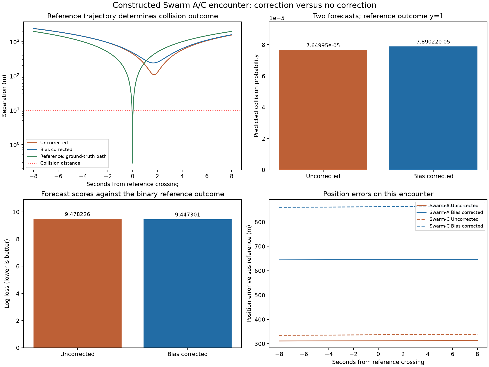
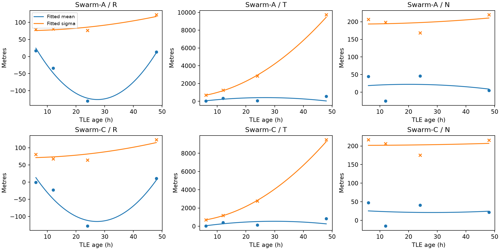

# Collision probability: forecasts versus a binary reference outcome

**Reference outcome: collision (y=1). The corrected forecast has the lower Brier score and log loss for this one encounter.**

This implements Sections 3–6 of [the simple guide](../../docs/Collision_Avoidance_Simple_Guide.md). Only the corrected and uncorrected prediction models receive covariances and collision probabilities. Reference trajectories supply a deterministic collision/no-collision label.

The input is the fixed time-shifted Swarm A/C case. Original GPS-based precise-orbit and SGP4 trajectories share synthetic timestamps while retaining native times and TLE ages. This is a constructed encounter, not an observed historical collision.

## Ground truth from the reference trajectories

The continuous reference minimum separation is **0.286440 m**. Treating the reference trajectories as exact, y = 1 if minimum separation <= R_A + R_C, otherwise y = 0.

The illustrative radius assumptions are A = 5 m and C = 5 m. Their sum is the **10 m collision distance**; it is not the radius of each satellite. These values are configurable and are not measured spacecraft dimensions.

The reference outcome is therefore **collision**, with label **1**. No reference covariance or reference Pc is calculated.

All methods assess the same preselected crossing within ±120 s of its saved center. The full two-hour trajectories contain three separate approaches; their minima are retained as separate geometry diagnostics.

## Forecasts and outcome scores

| Method | TCA offset (s) | Predicted miss (m) | Pc | Brier score | Log loss |
|---|---:|---:|---:|---:|---:|
| uncorrected | 1.735485 | 107.794009 | 7.64995337e-05 | 0.9998470068 | 9.478225912 |
| corrected | 1.669834 | 238.246537 | 7.89022238e-05 | 0.9998422018 | 9.447301146 |

Brier score is (Pc - y)^2. Binary log loss is -y log(Pc) - (1-y) log(1-Pc). Lower is better for both. Because this encounter has y=1, a higher Pc produces a better score on this event. For an encounter with y=0, a lower Pc scores better.

One selected collision case does not reveal the true forecast probability or establish that either method is generally calibrated. Validation needs many independently evaluated collision and non-collision encounters. The small improvement here also does not erase the fact that both forecasts assign very low probability to this selected collision.

Each forecast has its own refined TCA and encounter plane. The methods share the same learned covariance function and radii; the projected matrices can differ because their TCA and plane differ. The reference geometry is not used to tune either correction or covariance.

A larger Euclidean miss can still yield a larger Pc under anisotropic covariance: the full projected mean and covariance determine the integral.

## Fitting and held-out checks

Only Swarm A/C calibration forecasts are used: issue dates January 1–17, 2025 train the model; January 18–20 form the gap; January 21–31 are held out. Training reference targets precede test issue dates. Encounter reference positions never fit model parameters.

States are converted to GCRS before subtraction. Training uses reference RTN errors and full K-1 sample covariance in each horizon bin. Marginal Gaussian likelihood fits quadratic means and standard deviations with positive sigma intercepts and nonnegative growth coefficients. Standardized training residuals supply a full correlation matrix, giving P_RTN = D Gamma D. Inference rotates these parameters with the predicted RTN basis.

The correction adds U mu(tau) to SGP4. The uncorrected method keeps the original mean with the same centred covariance, making this a controlled mean-correction comparison. It is not a separately refitted zero-mean covariance baseline.

| Satellite | Technique | Held-out rows | Position RMSE (m) | Gaussian NLL | 95% coverage |
|---|---|---:|---:|---:|---:|
| Swarm-A | uncorrected | 116 | 1351.668 | 21.814 | 92.24% |
| Swarm-A | corrected | 116 | 1339.936 | 21.486 | 93.10% |
| Swarm-C | uncorrected | 112 | 1517.912 | 21.873 | 94.64% |
| Swarm-C | corrected | 112 | 1457.615 | 21.500 | 92.86% |

At the saved reference crossing center:

| Satellite | Original position error (m) | Corrected position error (m) |
|---|---:|---:|
| Swarm-A | 312.017 | 645.002 |
| Swarm-C | 336.642 | 862.234 |

A better probability score on this event does not imply that individual position errors improve. Both position and probability results should be inspected.

## Numerical checks and limits

- Positive-definite covariances, polar Gauss–Legendre quadrature refinement and seeded Monte Carlo cross-check the two forecast probabilities. Monte Carlo draws are hypothetical prediction outcomes, not ground-truth labels.
- Mean velocities are derivatives of continuous position curves, including the changing bias. The supplied SGP4 velocities construct the predicted RTN basis.
- Short-encounter duration, projected curvature, direction change and covariance variation are recorded per method.
- Independent object errors are assumed; cross-object covariance is unverified. Gaussian tails, reference error and the illustrative size assumptions remain limitations.
- No verified maneuver log was supplied. All residuals were retained without clipping; maneuver contamination remains unresolved.
- No avoidance maneuvers are implemented.

## Outputs and rerun

`summary.json` separates ground_truth, encounter_results and outcome_scores. It also records fitted models, covariance matrices, integration/Monte Carlo checks, held-out scores and source hashes. `prediction_errors.json` contains reference-basis errors. `encounter_trajectories.csv` stores both objects’ reference, original and corrected positions at shared timestamps.

```sh
python experiments/collision_probability/run_experiment.py --data-dir /path/to/data
python scripts/check_collision_results.py
```

The core downloader supplies every raw input. Missing shifted bundles are reconstructed from the checked-in recipe. Override radius assumptions with --radius-a-m and --radius-c-m. Optional maneuver exclusions use --maneuver-intervals and a CSV with satellite,start_utc,end_utc.




