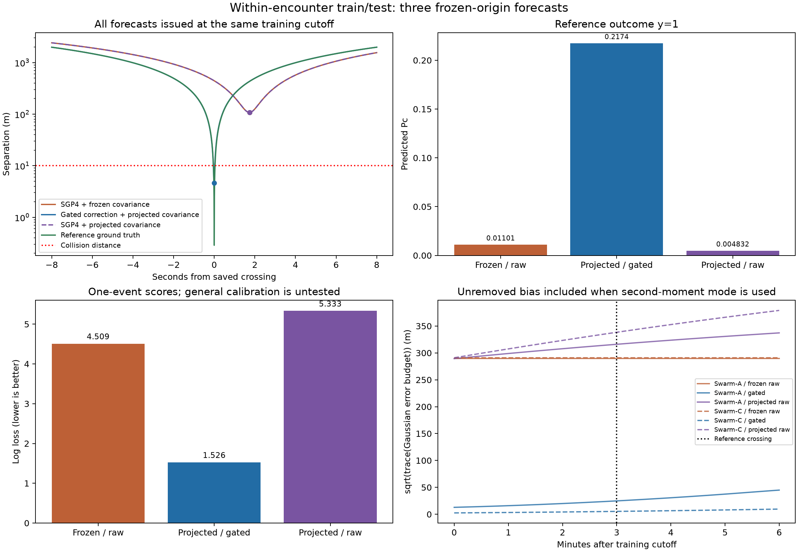
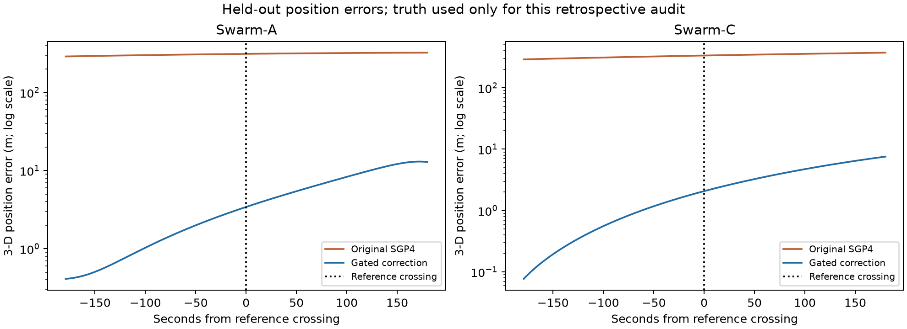
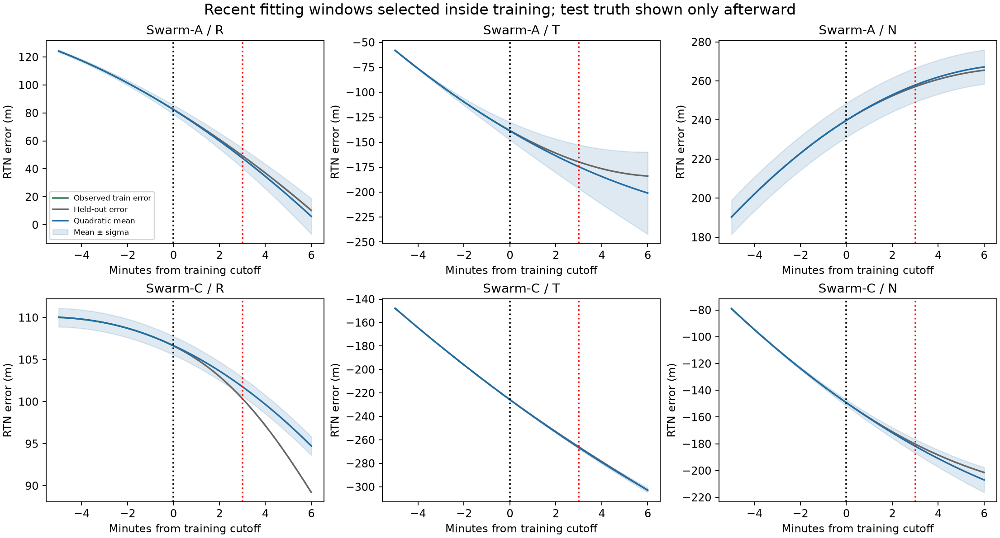
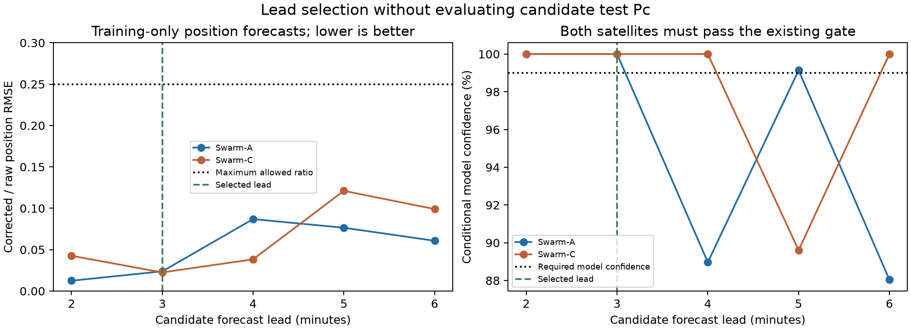

# Balanced forecast window and explicit uncertainty baselines

**Selected lead: 3 minutes. Test duration: 6 minutes. Best score on this constructed event: Gated correction + projected covariance.**

## Window choice without test-probability selection

Training prefix: 2025-01-30T19:54:01.692525Z through **2025-01-30T20:51:01.692525Z** (3421 timestamps per object). Test: **2025-01-30T20:51:02.692525Z through 2025-01-30T20:57:01.692525Z** (360 timestamps). Later source data are excluded.

Candidate leads were 2, 3, 4, 5 and 6 minutes, with symmetric test windows. All selection reference data end at elapsed time -360 s, the earliest candidate training cutoff. No candidate test reference outcome, test position error or Pc is used to choose the split.

The fixed rule chooses the longest lead for which both objects pass the 99% confidence gate and training-only rolling validation reduces position RMSE by at least 75%. Between three and six nonoverlapping validation blocks are used, depending on available history. A final refit can still withhold correction; the test result is never used to select another split.

| Candidate lead (min) | Training validation blocks | A: corrected/raw RMSE | C: corrected/raw RMSE | Eligible for both |
|---|---:|---:|---:|---|
| 2 | 6 | 0.0125 | 0.0426 | True |
| 3 | 6 | 0.0238 | 0.0225 | True |
| 4 | 6 | 0.0869 | 0.0383 | False |
| 5 | 4 | 0.0765 | 0.1211 | False |
| 6 | 4 | 0.0607 | 0.0990 | False |

Four- to six-minute leads may have useful average position forecasts but fail at least one satellite’s existing 99% model gate. They are not adopted just to obtain more appealing probabilities.

## Why the raw-SGP4 probabilities changed

This run uses **second_moment** uncertainty mode. Changing the window alone is not an appropriate way to repair implausible probabilities.

The fitted Gaussian error model has bias mu and centred covariance P. P describes residual scatter after removing the fitted bias. Using only that narrow P around an uncorrected trajectory ignores the unremoved systematic offset. For an explicit zero-mean Gaussian baseline, the error second moment about the displayed mean is S = P + (mu−d)(mu−d)^T, where d is the applied correction. For raw SGP4 d=0; for a fully applied mean correction d=mu and S=P. A gated variance-shrunk correction leaves its small unapplied bias in S.

**S is a second moment, not the true centred covariance of a biased error.** Assigning N(displayed mean,S) is a stated zero-mean Gaussian approximation and a different uncertainty assumption. The independent-object baseline adds the two object error budgets. These probabilities are conditional on that model; moderate-looking numbers do not prove calibration.

The original centred-residual-only comparison is retained below to isolate correction with the same residual covariance.

## Three primary forecasts

| Technique | Displayed position mean | Local Gaussian error budget in second-moment mode |
|---|---|---|
| SGP4 + frozen error budget | Original SGP4 | P(0) + mu(0)mu(0)^T, frozen |
| Gated correction + projected error budget | SGP4 + U(t)d(h) when permitted | P(h) + (mu(h)−d(h))(mu(h)−d(h))^T |
| SGP4 + projected error budget | Original SGP4 | P(h) + mu(h)mu(h)^T |

All matrices rotate with the predicted RTN basis into common GCRS. The original TLE epochs are preserved. Gates, fitting windows and covariance calibration are frozen at the forecast origin. Reference trajectories supply only a binary collision label, with no reference covariance or Pc.

Reference minimum separation: **0.286440 m**. Assumed radii A=5 m and C=5 m give a 10 m combined collision distance. Outcome y=1.

| Technique | Predicted miss (m) | Pc | Brier score | Log loss |
|---|---:|---:|---:|---:|
| SGP4 + frozen covariance | 107.794009 | 0.0110101026 | 0.97810102 | 4.508942 |
| Gated correction + projected covariance | 4.629264 | 0.217413474 | 0.61244167 | 1.525954 |
| SGP4 + projected covariance | 107.794009 | 0.00483154072 | 0.99036026 | 5.332590 |

## Original residual-covariance-only controls

Same selected window, models, gates and mean trajectories; only the Gaussian uncertainty assumption changes back to centred P for every method.

| Technique | Pc using only centred residual covariance | log(Pc) |
|---|---:|---:|
| SGP4 + frozen covariance | 4.79577042e-59 | -134.284786 |
| Gated correction + projected covariance | 0.22027594 | -1.512874 |
| SGP4 + projected covariance | 4.92304912e-14 | -30.642263 |

Brier score is (Pc−y)^2 and binary log loss is −y log(Pc)−(1−y) log(1−Pc); lower is better. A higher Pc scores better for this selected collision case, not necessarily for other events. Retained log(Pc) distinguishes probabilities that underflow floating-point storage.

## Confidence gating and held-out position accuracy

The threshold remains 99% conditional Gaussian confidence that a variance-shrunk correction reduces position error. Candidate fitting windows are 5, 10, 15 and 30 minutes. Training-only rolling position forecasts choose the fit window and inflate residual spreads using their forecast errors. The gate must also improve RMSE and at least the threshold fraction of positions in every training validation block. It never uses test truth or Pc.

| Satellite | Selected recent fit (s) | Minimum model confidence | Correction allowed |
|---|---:|---:|---|
| Swarm-A | 300 | 0.9999999985 | True |
| Swarm-C | 300 | 1.0000000000 | True |

The following position audit is computed after predictions are frozen and never changes the gate:

| Satellite | Changed | Improved | Worsened | Raw error at crossing (m) | Corrected error (m) |
|---|---:|---:|---:|---:|---:|
| Swarm-A | 360 | 360 | 0 | 312.016611 | 3.424545 |
| Swarm-C | 360 | 360 | 0 | 336.641786 | 2.071120 |

## Limits and reproducibility

- This is the same previously inspected, constructed collision case. It is not independent confirmation of probability accuracy. The 99% gate is model confidence, not an empirical success guarantee.
- Reference states are interpolated and nearby samples/validation blocks are correlated. Gaussian errors, independent objects and illustrative radii remain assumptions. More moderate Pc values do not establish that the uncertainty is calibrated.
- Training-only lead selection maximizes usable lead subject to fixed position criteria. Neither the test Pc nor a requirement that correction win enters selection. Longer failed candidates are retained in window_selection.json.
- Tests perturb all reference data after the common selection cutoff and check that the selected lead is unchanged. Additional tests check second moments analytically and preserve means across uncertainty modes.
- Source and model hashes, exact time split, gate and position audit, projected parameters, primary and residual-only matrices, quadrature refinements and Monte Carlo checks are saved.

```sh
python experiments/encounter_train_test/run_experiment.py --data-dir /path/to/data
# Reproduce the previous two-minute, residual-covariance-only experiment:
python experiments/encounter_train_test/run_experiment.py --data-dir /path/to/data --training-cutoff-s -120 --test-end-s 120 --covariance-mode residual
```








